# P1.6 检测项目与标准方法字典统一验收

开发环境：Carl 开发站 `192.168.10.204`，site `carl`。本阶段未访问、未修改生产站 Carl-1。

## 业务模型

统一为五类对象，不新增重复的检测项目或标准概念：

1. `Test Project`（检测项目）：全平台统一的检测服务项目。
2. `Test Object`（检测对象）：产品、材料、零部件及其受控分类。
3. `Test Standard`（检测依据：标准/方法）：保留标准编号、名称、版本、完整名称、实施日期、附件，并新增依据类型。
4. `Laboratory Capability`（实验室能力）：实验室、对象、项目、依据和限制范围的独立明细。
5. ERPNext `Item`（服务商品）：非库存服务，关联公共检测项目，用于报价和销售。

`Test Method` 暂作为兼容数据保留，不删除、不改名；它的业务属性迁移到 `Test Project`，原有报价与委托关联继续可用。

## 字段迁移表

| 原对象/字段 | 新对象/字段 | 实际处理 |
| --- | --- | --- |
| `Test Method.method_name` | `Test Project.project_name` | CNAS 方法优先取原始批次 `item_name`；无批次名称时去除 ` [CNAS 编码]` 后缀。按规范化后的精确名称归并，不做相似度或模糊合并。 |
| `Test Method.category` | `Test Project.category` | 作为缺省分类写入；已有项目分类不覆盖。 |
| CNAS `custom_raw_names` | `Test Project.aliases` | 按 `/` 拆分，仅保留不同于正式名称且未被项目占用的原文别名。 |
| CNAS `description` | `Test Project.description` | 仅写入非空且不同于项目名称的说明。 |
| `Test Method.default_standard` | `Test Project Standard.test_standard` | 建立项目与标准的独立关联行。 |
| `Laboratory Capability.test_standard` | `Test Project Standard.test_standard` | 按能力明细汇总到项目的多个标准，不写入单个文本字段。 |
| `Laboratory Capability.product_scope` | `Test Object.object_name`、`Test Project Object.test_object` | 原文保留，同时按原文精确去重建立受控对象；CNAS 对象分类使用能力的 `industry`。 |
| `Laboratory Capability.test_method` | `Laboratory Capability.test_project` | 通过 `Test Method.test_project` 回填；旧 `test_method` 字段保留。 |
| `Laboratory Capability.condition_schema` | `Test Project.condition_template` | 只有项目内恰好一个非空模板且项目模板为空时才回填；多条不同模板保留在能力明细，不丢失差异。 |
| `Item.custom_reli_test_method` | `Item.custom_reli_test_project` | 保留 Item，补充公共项目关联；服务 Item 仍为非库存、可销售服务。 |
| `Quotation Item.custom_reli_capability` | `custom_reli_test_project`、`custom_reli_test_object`、`custom_reli_test_standard` | 回填报价行的项目/对象/依据，并以项目中文名更新显示名；能力 ID 继续保留。 |
| `Test Request Item.capability` | `test_project`、`test_object` | 按能力回填；依据、能力 ID、条件快照、报价来源不覆盖。 |
| `Test Request Item.test_method` | `test_project` | 对无能力的历史行，通过兼容方法回填项目。 |
| `Test Program Item.test_method` | `test_project`、`test_object` | 通过方法和原委托行回填，保留履约历史。 |
| 旧 `Detection Project` | `Test Project` | 不再作为业务概念使用；DocType 已退休，历史表数据保留 124 行用于审计。旧字段隐藏、只读，不作为新数据入口。 |

`Test Standard` 原有标准编号、名称、版本、完整名称、实施日期和附件均保留；新增 `basis_type`，取值为国家标准、行业标准、国际标准、企业标准、实验室方法、其他方法文件。业务页面统一使用「检测依据（标准/方法）」。

## Carl 开发站数据结果

最终迁移及重复执行 `migrate` 后，计数和来源哈希保持不变。

| 数据 | 数量/结果 |
| --- | ---: |
| 检测项目 `Test Project` | 118 |
| 已归类 / 待分类 | 118 / 0 |
| 检测对象 `Test Object` | 42 |
| 项目—检测依据关联 | 638 |
| 项目—检测对象关联 | 396 |
| 检测依据 `Test Standard` | 214 |
| 其中：国家标准 / 行业标准 / 国际标准 | 128 / 25 / 49 |
| 其中：企业标准 / 其他方法文件 | 1 / 11 |
| 实验室能力总数 | 652 |
| 其中：CNAS 能力 | 650 |
| 其中：演示能力 | 2 |
| 兼容检测方法 `Test Method` | 126，其中 120 条已关联项目 |
| 已关联项目的非库存服务商品 | 5 |

未关联项目的 6 条方法为 3 条 DEMO 和 3 条 `TEST ...` 合成验证方法，均为非正式业务数据。项目规范名和对象规范名均无重复。CNAS 能力的项目、标准、来源、来源行、对象缺失数均为 0。

关系证据：

- 2 个项目关联多个实验室；`TPR-01365 低温试验` 有 2 个实验室、40 条能力、39 项标准。
- 72 个项目关联多个标准；`TPR-01382 振动试验` 关联 51 项标准。
- 52 个项目关联多个检测对象。
- 63 项标准服务多个项目；`STD-00354 GB/T 30489` 服务 19 个项目。
- 通过项目、对象、标准和实验室四个条件联合筛选，命中 `CAP-00701`（`低温试验` / `船舰设备` / `GJB 5B:2014` / 苏州旭博）。

CNAS 来源仍在 `CAPSRC-00499`：650 条能力、118 条方法、207 条标准、660 条原始行；结构化 JSON 为 833,923 字节，SHA-256 为 `fa716f04c0fc867f7a37d6c0716face1cc5195eb6e5c776c760c2af797531fd7`。来源行（`source_row`）和能力来源字段均保留。

## 业务界面验收

### 能力中心与字典

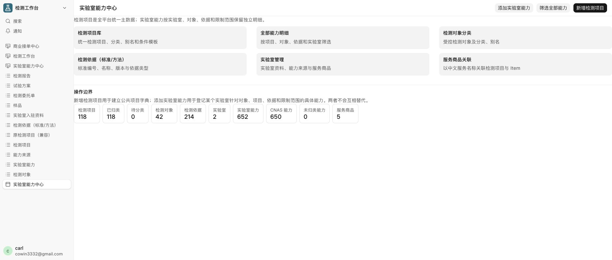

「实验室能力中心」保留六个入口；「新增检测项目」和「添加实验室能力」是两个独立操作。页面显示 118 个项目、118 已归类、0 待分类、650 条 CNAS 能力。

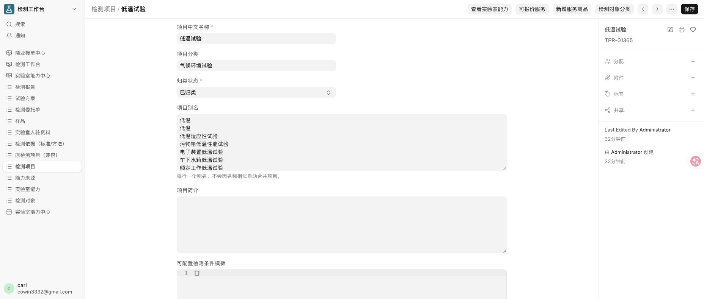

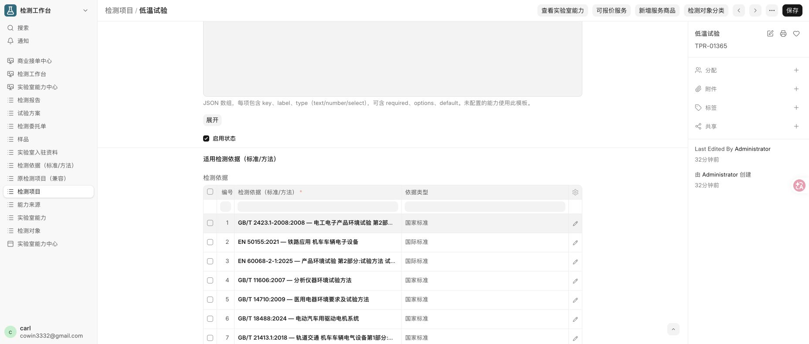

`TPR-01365 低温试验` 的详情关联 39 项检测依据，页面显示依据编号、名称和依据类型。

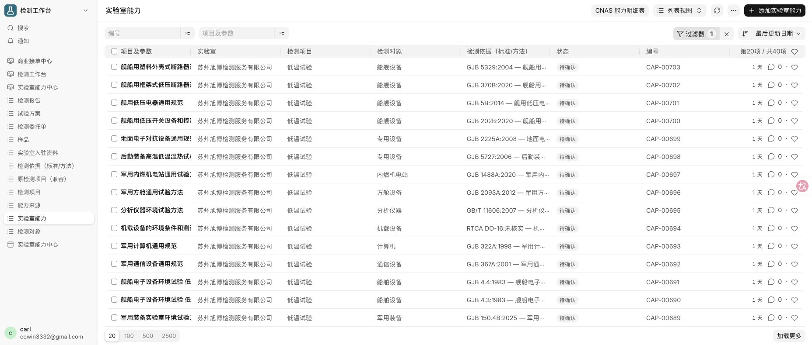

从项目详情打开能力列表，显示该项目的 40 条能力和 2 个实验室；按项目、对象、依据、实验室联合筛选时命中同一条能力：

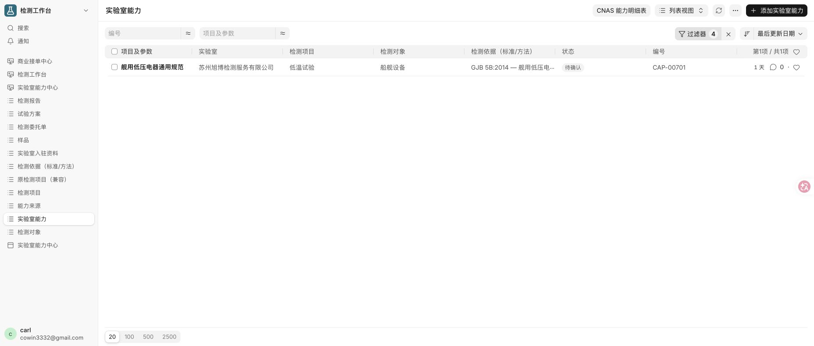

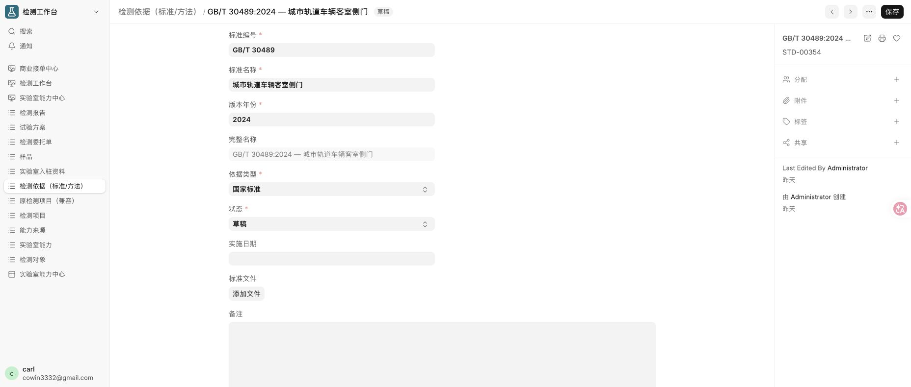

检测依据页面统一显示「检测依据（标准/方法）」；编号和名称组合显示，依据类型可选，附件入口保留。

### 实验室、来源与追溯

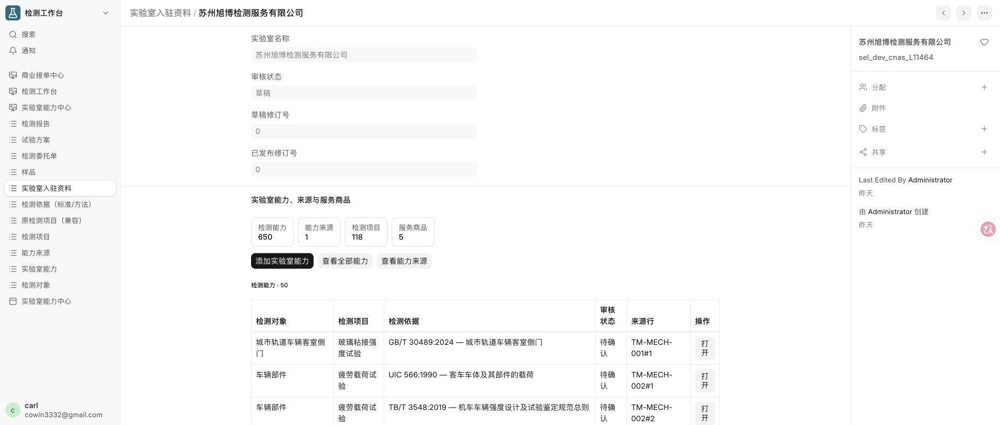

实验室资料、650 条能力、1 个能力来源和 5 个服务商品进入同一个实验室详情，不再拆成重复工作台。

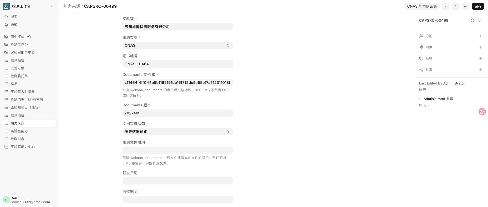

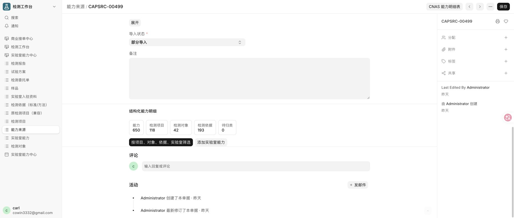

来源详情保留 Documents 文档 ID、版本、证书编号、审核状态和结构化明细入口；结构化明细显示能力 650、检测项目 118、检测对象 42、检测依据 193、待归类 0。

### 报价与委托兼容

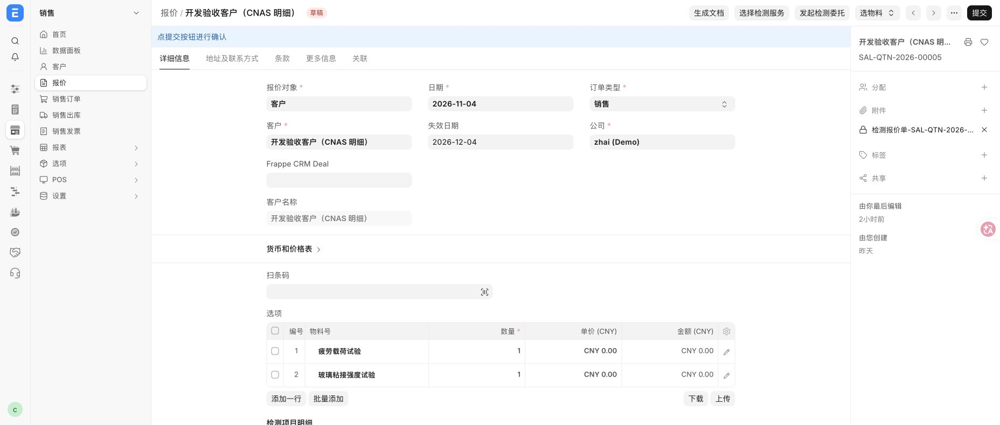

`SAL-QTN-2026-00005` 仍可打开和编辑，两行均显示中文服务名称；项目、对象、依据、能力 ID 和条件快照保存在行数据中，未把内部 Item 编码显示成检测项目名称。

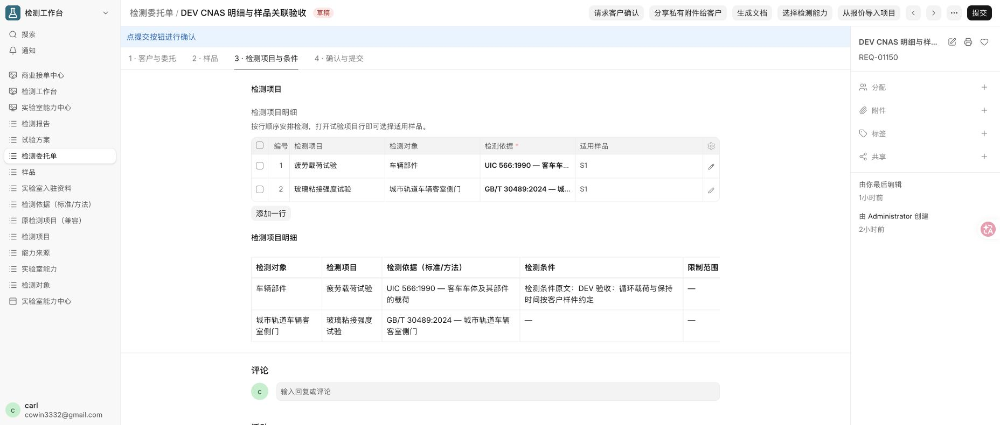

`REQ-01150` 仍可打开和编辑，检测项目与条件页显示两行中文项目、对象、依据、实验室、条件和限制范围；原报价来源及技术快照仍在。

数据库对账：报价两行的 `custom_reli_test_project` / `custom_reli_test_standard` / `custom_reli_capability` 分别为 `TPR-01391 / STD-00491 / CAP-00501` 和 `TPR-01392 / STD-00354 / CAP-00500`；委托两行保留相同能力和标准，并分别关联原报价行 `45htriflf9`、`45ht7qfg0e`，数量均为 1。两条记录仍为草稿状态。

## 验收清单

| 验收项 | 结果 |
| --- | --- |
| 650 条 CNAS 能力完整保留 | 通过；650 条 CNAS + 2 条演示能力，来源行和来源字段无缺失。 |
| 多实验室共享同一检测项目 | 通过；2 个项目存在多实验室，`TPR-01365` 为 2 个实验室。 |
| 一个项目关联多个标准/方法 | 通过；72 个项目，最多 51 项标准。 |
| 一个标准/方法关联多个项目 | 通过；63 项标准，最多 19 个项目。 |
| 按项目、对象、标准、实验室找到能力 | 通过；四维联合筛选命中 CAP-00701，自动测试覆盖四个维度。 |
| 检测项目关联 ERPNext Item | 通过；5 个非库存、可销售中文服务 Item 已关联项目。 |
| 现有 Quotation、Test Request 可打开和编辑 | 通过；SAL-QTN-2026-00005、REQ-01150 页面可打开。 |
| 中文业务名称正确显示 | 通过；项目、服务、对象、标准均以中文名称显示。 |
| 能力来源及原始 CNAS 信息可追溯 | 通过；CAPSRC-00499、source_row、Documents ID/版本与 JSON 哈希保存。 |

## 回归与迁移

Carl 开发站最终全量回归：50 个集成测试通过，另有 1 个独立文件可见性测试通过。回归覆盖能力字典、四维筛选、服务商品、多实验室/多标准关系、客户确认、报价转委托、照片复制和既有履约链路。

最终 `migrate` 重复执行成功；迁移前后项目 118、能力 652（CNAS 650）、标准 214、关联 638/396 及来源哈希均保持不变。

本阶段代码提交：

- `16b29f7` feat: unify test project and capability dictionary
- `1e36880` fix: preserve project labels in capability quotation
- `635c7e4` fix: retire legacy detection project safely
- `af25d12` fix: persist project dictionary relations on capability save
- `5a966e3` test: cover unified project dictionary and confirmed intake

未扩展商城功能；本阶段仅完成检测项目、检测依据、实验室能力和服务商品的字典统一及兼容迁移。
