# P4 Carl 开发站验收

验收日期为 2026-11-06。所有演示对象明确标注为软件验收或虚构。方案状态推进用于验证软件与设备快照，实际结果和结论保持空白。

设计与字段映射见 [P4 设计](../P4_ORDERS_EQUIPMENT.md)。本轮基于 PR #20 `cde7f48` 建立独立 worktree，该基线已包含 PR #18 `25daf65`、PR #19 `9f1f7dc`。分支为 `codex/p4-orders-equipment`，已有 PR 保持原状态。

## 实际单据与页面

| 对象 | 编号 | Carl Desk URL |
|---|---|---|
| 混合报价 | SAL-QTN-2026-00010 | http://carl:8000/desk/reli-lims/quotation/SAL-QTN-2026-00010 |
| 销售订单 | SAL-ORD-2026-00006 | http://carl:8000/desk/reli-lims/sales-order/SAL-ORD-2026-00006 |
| 正式受理委托 | REQ-01546 | http://carl:8000/desk/reli-lims/test-request/REQ-01546 |
| 样品 | SMP-01547 | http://carl:8000/desk/reli-lims/sample/SMP-01547 |
| 试验方案 | PRG-01548 | http://carl:8000/desk/reli-lims/test-program/PRG-01548 |
| 自用设备资产 | ACC-ASS-2026-00002 | http://carl:8000/desk/reli-lims/asset/ACC-ASS-2026-00002 |
| 检测项目 | TPR-01541 | http://carl:8000/desk/reli-lims/test-project/TPR-01541 |
| 演示能力 | CAP-01545 | http://carl:8000/desk/reli-lims/laboratory-capability/CAP-01545 |
| 试验记录查询 | P4 关键词 | http://carl:8000/desk/reli-lims/reli-test-records |
| 实验室能力中心 | 实验设备入口 | http://carl:8000/desk/reli-lims/laboratory-capability-center |

报价有三行，检测服务 600 元、普通培训服务 200 元、实物夹具商品 100 元，合计 900 元。销售订单保留三行，自动委托只包含检测服务一行。自用设备的资产物料设为不可销售，与上述销售商品分别登记。

## 十项业务验收

| 验收项 | 实际结果与证据 |
|---|---|
| 客户接受报价 | 授权接口登记虚构客户接受凭据，报价展示接受时间和记录，原生状态为已下单。见截图 01 |
| 创建并提交订单 | ERPNext 原生 mapper 生成订单并正式提交，三类商品均保留。见截图 02 |
| 自动生成检测委托草稿 | 委托初始无样品，保留检测服务、报价行、订单行和技术快照。见截图 03 |
| 普通服务和实物商品过滤 | 委托明细仅一行，排除培训及实物夹具。订单仍为三行，技术快照审计通过 |
| 重复执行幂等 | 正常 API 重试及 Desk“重试生成检测委托”返回同一委托，数据库委托数为 1 |
| 报价、订单、委托跳转 | 报价原生关联面板进入订单列表和详情，订单按钮进入委托，委托来源按钮返回订单或报价 |
| 客户补充、确认、实验室审核和正式受理 | 浏览器保存样品与要求，无 Cookie、无登录凭据 HTTP 客户端保存和确认均为 200。Desk 审核通过并提交，生成 Project。见截图 04～06 |
| 客户报价 PDF 信息隔离 | 实际“生成文档”PDF 包含三类中文商品、条件和金额。正文无能力 ID、实验室来源标识、成本和供应字段。已逐页视觉检查并完成提取文字检查。原生默认打印 HTML 的同类检查亦通过 |
| 设备与项目、能力及方案关联 | Asset 关联项目和能力，项目中文检索设备后返回资产，方案实际选择设备并保存开始时的状态与校准快照。记录页显示设备中文名。见截图 07～10 |
| 原有组合回归 | 完整 Frappe 回归、离线回归、JS 回归及旧报价／委托打开检查，详见测试表和截图 11、12 |

## 字段迁移与审计结果

| 检查 | 结果 |
|---|---|
| 原始 CNAS 能力 | `CAPSRC-00499` 对应 650 条完整保留 |
| CNAS 原始结构数据 SHA-256 | `fa716f04c0fc867f7a37d6c0716face1cc5195eb6e5c776c760c2af797531fd7` |
| 技术快照 | 报价行、订单行、委托行、方案行规范化内容一致 |
| 来源关系 | 订单行对应 `REQ-01546`，委托行对应原生订单行，保留报价和报价行 |
| 确认状态 | `Lab Reviewed`，正式受理后确认指纹仍匹配 |
| 旧委托确认 | `REQ-01150` 的原确认指纹仍匹配 |
| 实验设备快照 | 启用，校准有效期 2027-11-06，型号 P4-CHAMBER，序列号 P4-SOFTWARE-001，设备区及捕获时间已保存 |
| 设备财务状态 | 演示 Asset 保留 Draft，实验设备启用状态单独记录 |
| 现场总量 | Test Project 120、Test Object 44、Test Standard 216、Laboratory Capability 660、Asset 2、Workstation 0，含已有开发演示及本轮虚构对象 |

完整机器审计见 [审计结果](p4/final-audit.json)。迁移仅为已有明确项目关联的非库存销售服务回填检测服务分类，原 CNAS 来源和公共项目映射保持可追溯。

## 回归测试

| 范围 | 结果 |
|---|---|
| 最终业务代码完整 Frappe 回归 | 87 项集成及 1 项附件权限回归通过（066752c） |
| 前一组合完整 Frappe 回归 | 85 项集成及 1 项附件权限回归通过 |
| 关键业务复验 | 订单混合过滤、防重、真正第二拆分组失败回滚、直接订单受理、设备状态／校准、部分客户提交日期序列化、报价接受防伪与复制保护 |
| 离线 Python | 107 项及 7 个子测试通过 |
| JS | 7 项通过，包含本轮新增的 Desk 审核和客户链接调用回归 |
| 构建及迁移 | 通过统一部署脚本执行，健康检查通过，运行目录 detached HEAD 且干净 |

完整集成日志对应 `066752c`。中文标签及撤销脚本路径修复在 `97355be` 完成，随后迁移、构建、107 项离线测试和数据审计再次通过。定向撤销脚本从应用目录 dry-run 成功。

日志见本目录 `p4/`。已覆盖原生订单取消阻断、订单范围变化提示、无检测服务订单不生成委托、来源防重和已保存技术快照锁定。

## 现场修复

现场发现并修复了无样品草稿被 Meta 必填阻挡、Guest 部分提交回填日期对象不能序列化、Desk 客户链接和实验室审核调用错误、设备候选选中后按 Asset 编号校验失败、商品编码抢占中文主显示等问题。

客户接受记录只能通过授权业务操作登记，新建报价不能伪造，正常复制报价不会继承原客户接受记录。新的订单行来源及服务数量参与确认指纹，旧非订单来源委托保持原指纹兼容。

## 验收口径与后续操作

本轮报价 PDF 通过现有“生成文档”流程验收，原生 Quotation 默认打印 HTML 亦已检查。直接由原生打印界面导出 PDF 的环境检查不计入本轮通过项。

订单变更或已有委托的订单修订进入人工处理提示。已有关联委托的订单取消被明确阻止，后续商业调整和技术重新确认由授权人员处理。

多样品的适用关系由实验室明确分配。订单来源草稿新增唯一一个客户样品时，在客户保存阶段关联全部检测行，然后取得客户确认。

临时客户演示密钥已通过规定脚本按 `REQ-01546` 定向撤销，副本已清理，相关错误日志已脱敏。委托已正式受理，复核使用上面的 Desk 链接。

## 真实截图

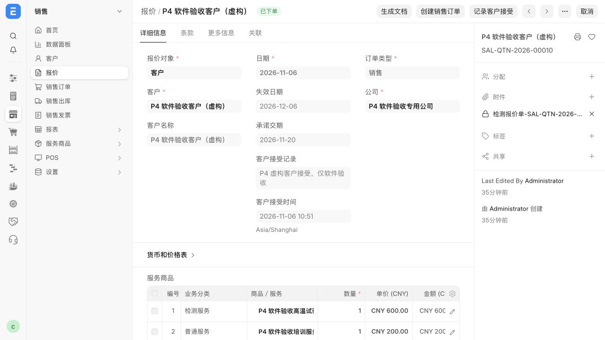
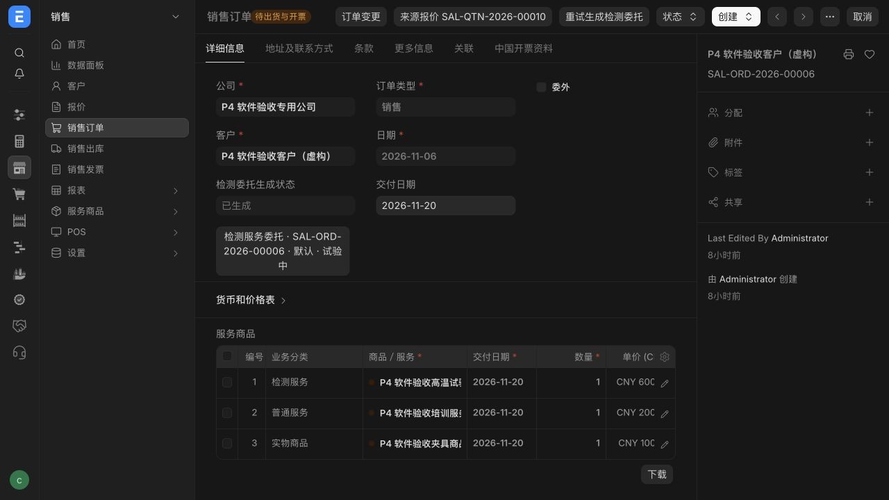
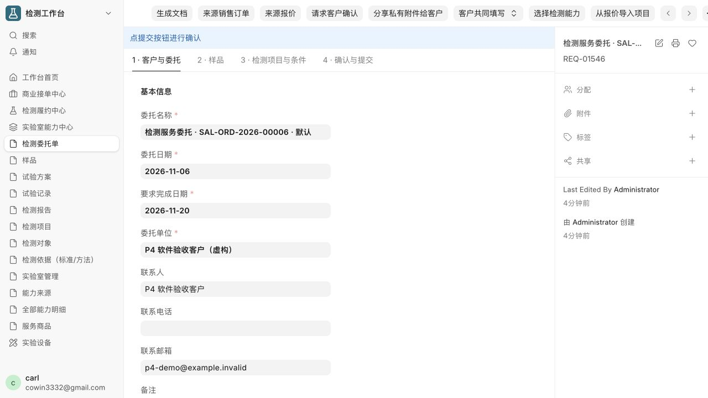
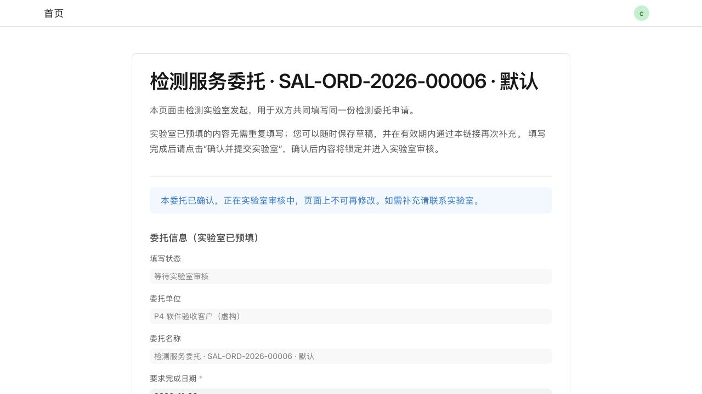

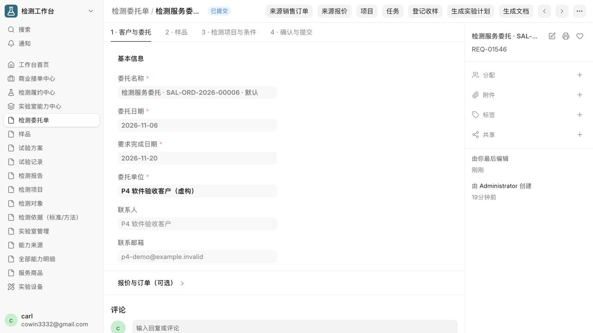
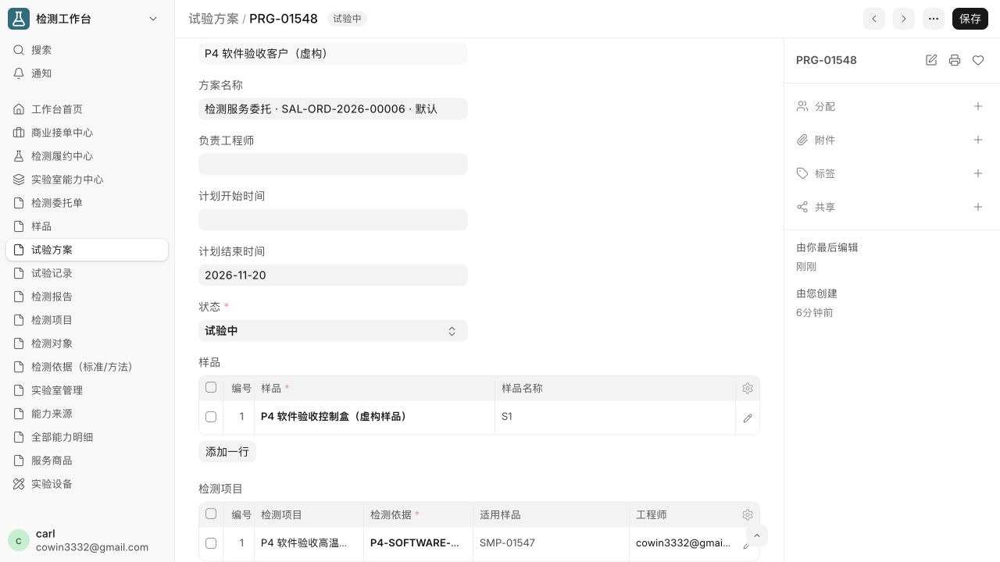
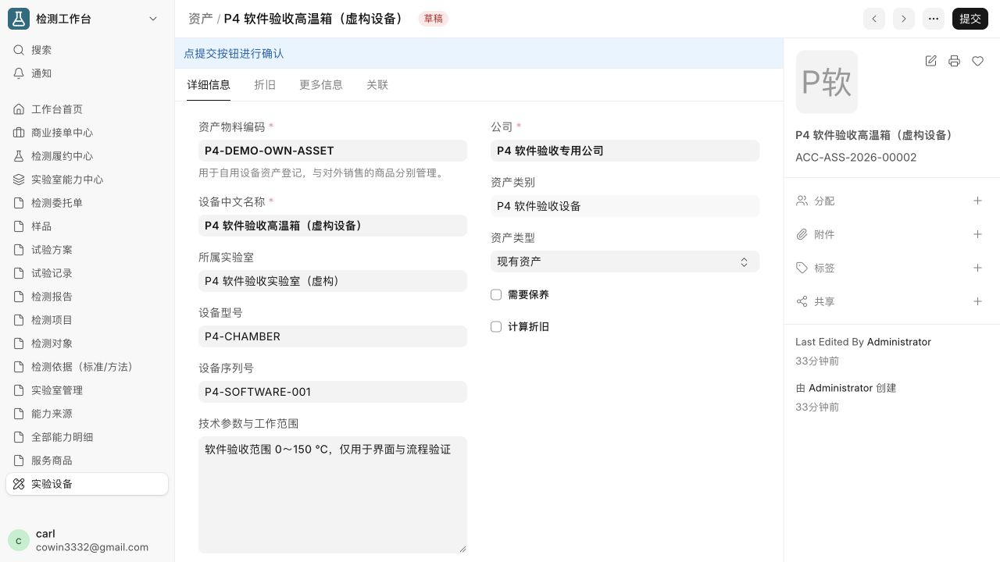
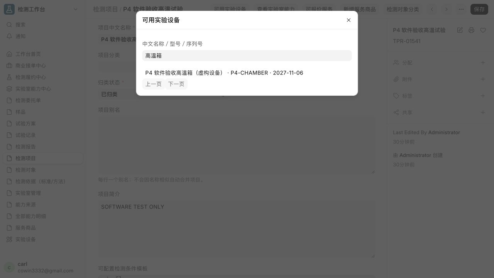
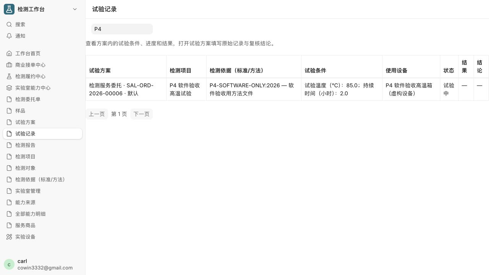
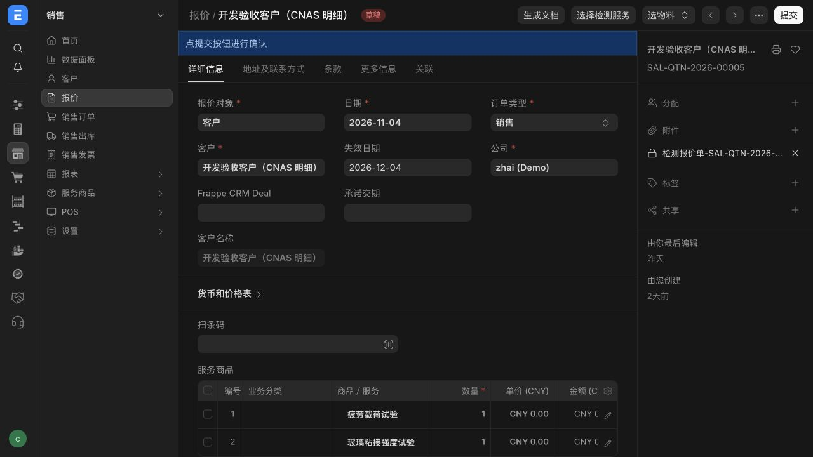
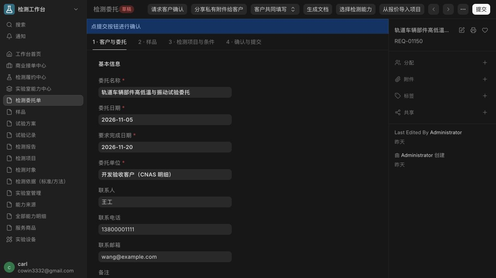
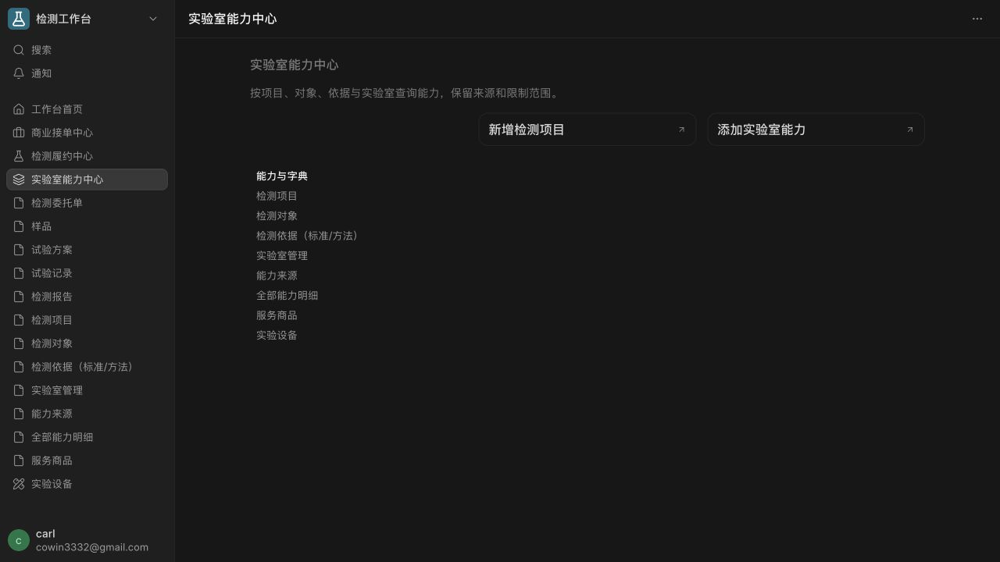
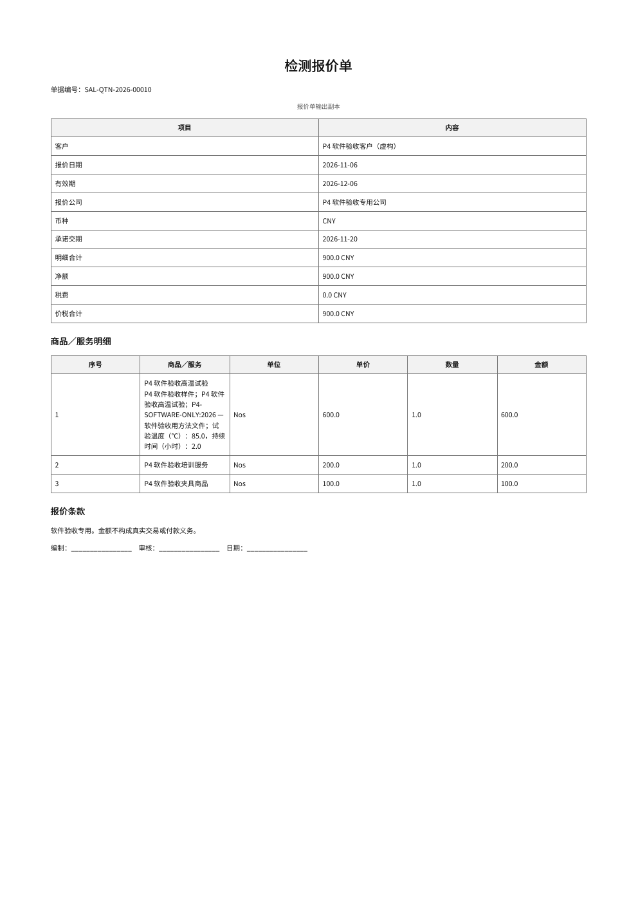
