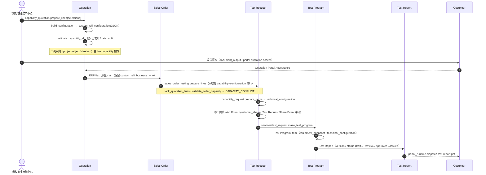

# 图 6 · Quotation → Sales Order → Test Request → Test Program → Test Report

证据边界：`Quotation → Sales Order` 使用 ERPNext 原生映射（非 reli_lims 代码），reli_lims 只提供字段与校验；`make_test_program` 实现在 `reli_lims/services/test_request.py:85`。
